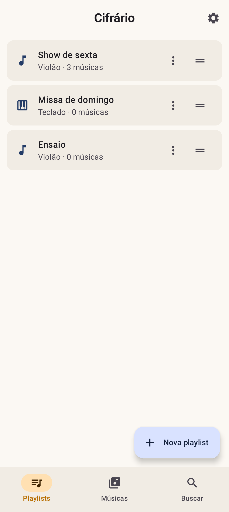
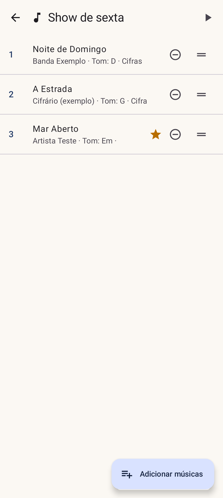
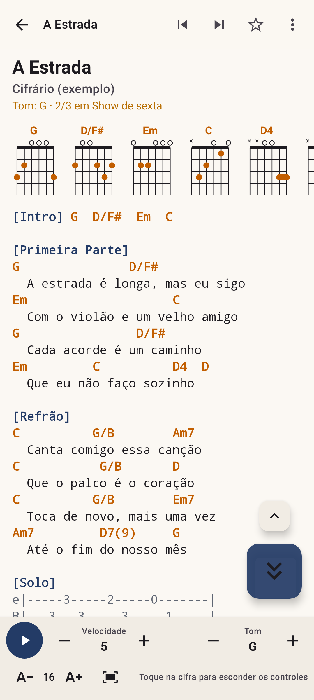
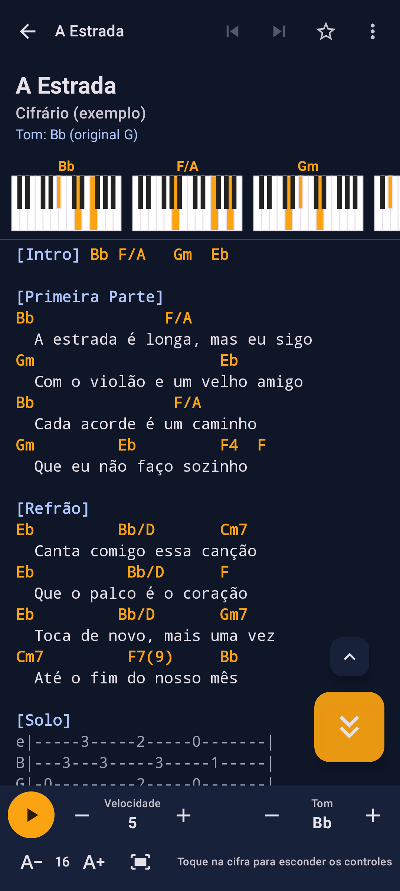

# Cifrário

App Android para guardar cifras offline, montar playlists (repertórios) para violão ou teclado e tocar com rolagem automática.

<p>




</p>

## O que o app faz

| Recurso | Como funciona |
|---|---|
| **Buscar cifras** | Aba *Buscar*: no Cifra Club a busca é nativa (lista de resultados no app); nos outros sites (Cifras, Ultimate Guitar, E-Chords) abre a busca do próprio site no navegador interno. Também dá para colar um link ou usar **Compartilhar → Cifrário** a partir do Chrome. |
| **Só sites específicos** | O navegador interno só abre Cifra Club, Cifras, Ultimate Guitar, E-Chords e a busca do Google. Links para outros lugares são bloqueados. |
| **Salvar offline** | Na página da cifra, toque em **Salvar cifra**. O app lê a página já carregada, extrai acordes + letra como texto e grava no banco local (Room/SQLite). Depois disso não precisa mais de internet. |
| **Playlists** | Crie quantas quiser, cada uma marcada como *Violão* ou *Teclado*. Arraste pela alça ≡ para ordenar as músicas **e** as próprias playlists. A mesma música pode estar em várias playlists. |
| **Rolagem automática** | Botão ▶ com velocidade de 1 a 20. A velocidade fica salva **por música**. |
| **Rolagem rápida** | Botão grande ⇊ no canto: desce um trecho da tela (padrão 60%, ajustável de 25% a 100% nas configurações). O botão ˄ volta um trecho. |
| **Modo palco** | Abrindo pela playlist, os botões ⏮ ⏭ levam à música anterior/próxima. |
| **Pedal Bluetooth** | Page Down/↓/Espaço desce, Page Up/↑ sobe, → / ← trocam de música, Enter liga/desliga a rolagem. Opcional: botões de volume rolam a cifra. |
| **Tom** | Transposição com − / + (salva por música), escolhendo sustenidos ou bemóis conforme a tonalidade. Mantém o alinhamento dos acordes sobre a letra. |
| **Diagramas** | Desenho dos acordes usados na música, para violão (calculado automaticamente, inclusive pestanas e baixos invertidos) ou teclado. |
| **Leitura** | Tamanho da letra, "ajustar à largura", tema claro/escuro, tela sempre ligada. |
| **Editar / escrever** | Corrija uma cifra salva ou escreva uma do zero (acordes numa linha, letra embaixo — o app reconhece sozinho). |
| **Backup** | Exporta/importa tudo (músicas, playlists, ordem, tom, velocidade) num arquivo `.json`. Também participa do backup automático do Android. |

## Tecnologia

- **Kotlin + Jetpack Compose** (Material 3), Android 8.0+ (minSdk 26), target/compile SDK 37.
- **Room** (banco offline), **DataStore** (configurações), **Navigation Compose** (rotas tipadas).
- **WebView** para navegar nos sites e **Jsoup** para extrair a cifra do HTML. Usar o WebView (e não baixar a página "por trás") é proposital: os sites têm proteção anti-robô que bloqueia downloads diretos, mas funcionam normalmente num navegador.
- **OkHttp** só para a busca do Cifra Club.
- Biblioteca `sh.calvin.reorderable` para arrastar e reordenar.

```
app/src/main/java/io/github/munhozmib/cifrario/
├── music/       Acordes: reconhecimento, transposição, notas, desenhos de violão/teclado
├── importer/    Sites suportados, leitura das páginas, busca do Cifra Club
├── data/        Room (músicas, playlists, ordem), repositório, backup, configurações
└── ui/          Telas: Playlists, Músicas, Buscar, Navegador, Cifra, Editor, Configurações
```

## Rodar no Android Studio

1. Android Studio atualizado (precisa suportar **Android Gradle Plugin 9.5** — versões de 2026).
2. *File → Open* → escolha a pasta `cifrario-android`.
3. Se pedir, instale o **SDK Platform Android 37.2** (*Tools → SDK Manager*).
4. Conecte o celular (com *Depuração USB* ligada) e clique em ▶ *Run*.

A versão de desenvolvimento se instala como "Cifrário" com o pacote `io.github.munhozmib.cifrario.debug`, então convive com a versão da loja.

Sem Android Studio: a cada push, o GitHub Actions (`.github/workflows/cifrario-android.yml`) roda os testes e gera o APK em *Actions → artefato `cifrario-debug-apk`*. Baixe no celular e instale.

## Testes

```bash
./gradlew :app:testDebugUnitTest      # 29 testes: acordes, transposição, diagramas, leitura de páginas, banco, backup, telas
./gradlew :app:recordRoborazziDebug   # regera as capturas de tela em docs/screenshots
```

Os testes de leitura de página usam HTML **sintético** com a estrutura de cada site (não há letras reais no repositório). Como os sites mudam o layout de vez em quando, há um extrator genérico de reserva (pega o maior bloco `<pre>` da página).

## Publicar na Google Play

1. **Conta de desenvolvedor**: [play.google.com/console](https://play.google.com/console) (taxa única de US$ 25). Contas pessoais novas precisam de um **teste fechado com 12 testadores por 14 dias** antes de liberar a produção.
2. **Chave de assinatura** (uma vez só, guarde bem e fora do Git):
   ```bash
   keytool -genkeypair -v -keystore ~/cifrario-upload.jks -alias upload -keyalg RSA -keysize 4096 -validity 10000
   ```
   Crie `cifrario-android/keystore.properties` (já está no `.gitignore`):
   ```properties
   storeFile=/caminho/para/cifrario-upload.jks
   storePassword=...
   keyAlias=upload
   keyPassword=...
   ```
3. **Gerar o pacote**: `./gradlew :app:bundleRelease` → `app/build/outputs/bundle/release/app-release.aab` (ou *Build → Generate Signed App Bundle* no Studio).
4. **Ficha da loja** — material pronto em `docs/play-store/`:
   - Ícone 512×512: `icone-512.png`
   - Imagem de destaque 1024×500: `feature-graphic-1024x500.png`
   - Capturas: `docs/screenshots/` (ou tire do seu celular, com suas músicas)
   - Política de privacidade: https://munhozmib.github.io/cifrario/privacidade.html
   - Segurança dos dados: "não coleta nem compartilha dados".
5. A cada nova versão, aumente `versionCode` e `versionName` em `app/build.gradle.kts`.

### ⚠️ Atenção: direitos autorais e regras da loja

As cifras pertencem aos autores e aos sites. Para **uso pessoal** o app é tranquilo. Já **publicar na Play Store para o público** um app que copia conteúdo do Cifra Club e de outros sites pode ser recusado pela Google (política de propriedade intelectual) e pode violar os termos de uso desses sites. Caminhos recomendados:

- **Uso pessoal / banda**: instale o APK direto, ou use o **teste interno** da Play Console (até 100 pessoas, sem ficar público).
- **Publicação aberta**: fale antes com os sites, ou tire os sites da busca e deixe o app só com "Escrever cifra" + compartilhar link — de preferência com orientação jurídica.

## Próximos passos possíveis

- Cifras em PDF/imagem (partituras) e anotações à mão.
- Metrônomo e contagem antes de iniciar a rolagem.
- Sincronizar entre aparelhos (Google Drive).
- Modo tablet com duas colunas.
- Mais sites (ex.: Letras.mus.br para letras sem acordes).
